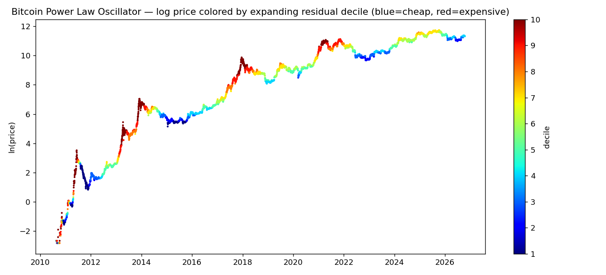

# crypto_finance

[](https://github.com/amanthakkar/crypto_finance/actions/workflows/ci.yml) [](LICENSE)


**Crypto cycle research, rebuilt as real software.** What started as five Jupyter notebooks (2021) is now a tested Python package with a CLI, a self-contained dashboard, and a live twin running in production.

> **Live version:** [amanthakkar.com/power-law-oscillator-indicator](https://www.amanthakkar.com/power-law-oscillator-indicator/?source=github) — the indicator page on my site recomputes these models daily on my homelab and renders 11 views (power-law family, classic gauges, on-chain). This repo is the open-source engine underneath the original research; a fresh run today reproduces the live site's readings within ~1–2% from independent public data.



## The v2 story: notebooks → causal code

The notebooks fit each model on the **whole sample** and plotted history as if you'd known it at the time. That's look-ahead bias, and it's why notebook backtests always look smarter than they were. Version 2 fixes it:

- **Expanding (causal) fits** — every value at day *t* uses only data up to *t*. Past values never rewrite when new prices arrive.
- **A test that proves it** — `tests/test_indicators.py` truncates the future and asserts no past value changes, recovers a known power law from synthetic data, and checks the supply schedule against known halving supplies.
- **Reusable modules, not cells** — data / indicators / composite / portfolio / charts / dashboard, with a CLI on top.

## Quick start

```bash
pip install -e .
crypto-finance indicators     # latest BTC readings + composite signal
crypto-finance dashboard      # writes outputs/dashboard.html + PNG charts
crypto-finance rainbow --coin ethereum
crypto-finance portfolio --coins bitcoin,ethereum,solana
crypto-finance stock-to-flow
```

**Sample output** (regenerate any time): [dashboard](docs/sample-output/dashboard.html) · [PLO chart](docs/sample-output/plo.png) · [BTC rainbow](docs/sample-output/btc_rainbow.png) · [ETH rainbow](docs/sample-output/ethereum_rainbow.png) · [efficient frontier](docs/sample-output/frontier.png)

## What's inside

| Module | What it does |
|---|---|
| `data.py` | Key-less public data with disk cache — BTC full history (blockchain.info), any coin ≤1y (CoinGecko), ETH full history (Coinbase Exchange, paged) |
| `indicators.py` | Power-law oscillator (expanding OLS on log₁₀ price vs log₁₀ days since genesis): residual, expanding percentile rank, decile, σ-risk; Santostasi-style corridor (global fit, labelled look-ahead); Mayer Multiple; Pi Cycle; MA-stretch risk; log-regression rainbows (log-time, BlockchainCenter construction); stock-to-flow from a programmatic halving-supply schedule |
| `composite.py` | The site's composite signal, ported 1:1 — every indicator votes in [−2, +2], plain average, all votes shown |
| `portfolio.py` | Efficient frontier from aligned daily log returns (365-day annualization — crypto trades every day, not 252), Monte-Carlo frontier, max-Sharpe & min-volatility portfolios |
| `charts.py` / `dashboard.py` | Matplotlib PNGs + a zero-dependency HTML dashboard (inline SVG, works offline) |

## The original research

Each notebook survives in [`notebooks/`](notebooks/), paired with the article that explains the method — and where the model breaks:

| Notebook | Question | Article |
|---|---|---|
| Efficient Portfolio | How do you size a crypto portfolio that isn't vibes? | [Start smart with an efficient portfolio](https://medium.datadriveninvestor.com/want-to-invest-in-bitcoin-and-crypto-start-smart-with-an-efficient-portfolio-built-using-python-3966bf70f453) |
| Regression Rainbows 1 & 2 | Where are we in the long cycle? | [Logarithmic regression for BTC & ETH](https://medium.datadriveninvestor.com/using-logarithmic-regression-to-predict-the-future-prices-of-bitcoin-and-ethereum-52f05e7b92b8) |
| Stock2Flow | Does stock-to-flow hold up? (Spoiler, kept honest in code: it overshot badly post-2021.) | [Stock-to-flow, summarized honestly](https://medium.datadriveninvestor.com/stock-to-flow-summarized-the-code-a-brief-outline-and-its-limitations-42a524163dde) |
| Power Oscillator | Can the power law give a cleaner cycle oscillator? | [Bitcoin's Power Law Oscillator](https://medium.datadriveninvestor.com/bitcoins-power-law-oscillator-the-code-a-summary-and-a-suggested-improvement-b78b59a2bc9c) |

## Honesty notes

- Power-law / corridor / rainbow views disagree with each other regularly; the composite exists so no single model gets to shout alone.
- Stock-to-flow is included as *history of an idea*, with its failure mode stated in the CLI output itself.
- On-chain gauges (MVRV, NUPL) run on the live site via BGeometrics; the composite here accepts them when present but the open-source pipeline is price-only.

## Disclaimer

Research and education only — not financial advice.

## License

MIT — see [LICENSE](LICENSE).
